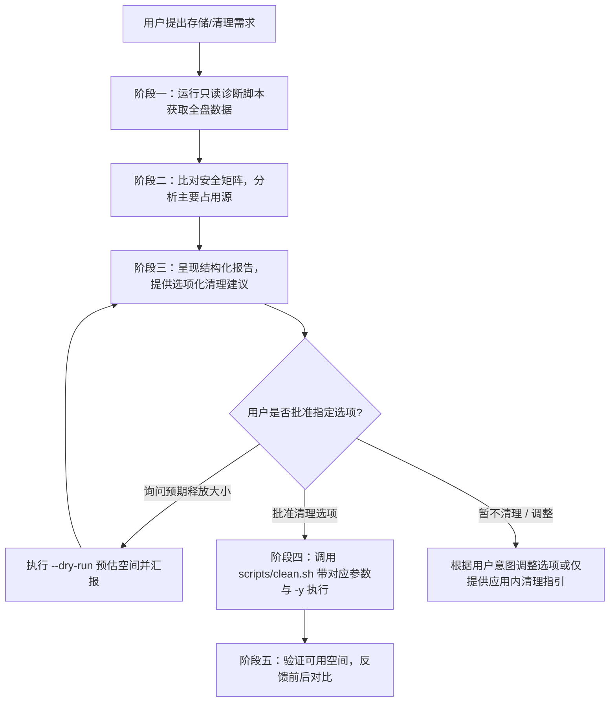

# macOS 智能存储诊断与安全清理专家技能 (Mac Cleaner Skill)

本技能为 AI 智能体（如 Antigravity、Claude Code 等）提供一套专业的 macOS 存储排查、归因诊断与人机协同安全清理的专家框架。

> [!IMPORTANT]
> **设计哲学：智能体原生 (Agent-Native) + 颗粒化选项控制**
> - **彻底摒弃“桌面应用程序”包装**：不使用 `.app`、`.command` 或弹出网页；所有诊断汇报与交互确认均在自然语言对话流中完成。
> - **支持指定选项颗粒化清理**：智能体与用户可通过明确的参数选项（如 `--caches`, `--xdg-cache`, `--dev`, `--maven`, `--parallels-pkg`, `--agent-caches`, `--cache-dir <name>`, `--pkg`, `--trash` 等）进行定向清理。
> - **非交互安全自动化**：清理脚本支持 `--yes` / `-y`（由 Agent 获准后自动化调用）和 `--dry-run`（空间预估），杜绝命令行挂起。

---

## 🧠 智能体的核心心智模型 (Mental Model)

1. **“系统数据 (System Data)” 不是一个物理文件夹**：
   - 苹果系统设置中的“系统数据”或“macOS”是一个**动态剩余分类**（计算方式：总已用空间 - 应用程序本体 - 媒体文件 - 文稿 - iCloud）。
   - 它主要由：**APFS 本地快照**、**沙盒应用数据 (`~/Library/Containers`)**、**应用持久配置 (`~/Library/Application Support`)**、**系统与用户级缓存 (`~/Library/Caches` & `~/.cache`)**、**开发工具与虚拟机镜像 (`~/Library/Android`, `~/.android`, `~/Library/Parallels`, `~/.m2`)**、**底层沙盒临时区 (`/private/var/folders`)** 以及 **可清除空间 (Purgeable Space)** 构成。
   - **严禁**向用户承诺有某个“系统数据文件夹”可以直接一键清空。

2. **以底层文件系统可用空间 (`df -h /`) 为唯一检验准则**：
   - 苹果图形界面的“存储空间”严重依赖 Spotlight 索引，更新具有滞后性。
   - 智能体验证清理成效时，必须以 `df -h /` 中的实际可用空间 (`Avail`) 为准。

3. **零误删与安全红线原则 (Zero Data Loss Rules)**：
   - 🚨 **系统保护区严禁修改**：绝不触碰 `/System`、`/Library`（非缓存类子目录）、`/private/var/vm`（交换分区与睡眠镜像）和 `/private/var/folders`。系统底层临时区若需释放，指导用户**彻底关机重启**即可自动回收。
   - 🚨 **聊天与协同软件沙盒禁止命令行强删**：微信 (`com.tencent.xinWeChat`)、企业微信 (`com.tencent.WeWorkMac`)、飞书 (`LarkShell`)、钉钉等位于 `~/Library/Containers` 或 `~/Library/Application Support`。直接删除会导致本地 SQLite 数据库损坏，**必须指导用户在客户端内进入【设置 -> 存储空间】安全清理**。
   - 🚨 **用户文稿与 Docker 命名数据卷禁止盲删**：`~/Documents`、`~/Desktop`、Docker Volumes、正在使用的虚拟机本体与 Android AVD 模拟器本体默认属于用户生产数据，未经明确确认绝不删除。

---

## 🔄 智能体标准工作流程 (Agent Workflow)



---

## 阶段一：执行非破坏性只读诊断 (Read-Only Diagnostics)

智能体在提出任何清理操作前，必须先获取当前的真实空间分布数据。

```zsh
# 快速非交互只读扫描（耗时约 2~3 秒，报告各核心位置大小与 Top 占用）
zsh ~/.gemini/config/skills/mac_cleaner/scripts/diagnose.sh
# 或在仓库根目录下运行：
zsh scripts/diagnose.sh

# 如需深度排查个人主目录（含隐藏目录一级子目录大小）：
zsh scripts/diagnose.sh --deep
```

---

## 阶段二：多维度根因归类与安全矩阵 (Safety Matrix)

| 清理选项 | 目标路径 / 动作 | 风险等级 | 说明与效果 |
| :--- | :--- | :---: | :--- |
| `--caches` (`-c`) | `~/Library/Caches/*` | 🟢 安全 | 用户应用临时缓存（网页、缩略图、自动更新包等）。应用启动时自动重建。 |
| `--cache-dir <name>`| `~/Library/Caches/<name>`| 🟢 安全 | **精准指定单一应用缓存**（如 Google, JetBrains, com.tencent.xinWeChat）。 |
| `--xdg-cache` | `~/.cache/*` | 🟢 安全 | XDG 通用工具与运行时缓存（如 `uv`, `codex-runtimes`, `fontconfig` 等）。 |
| `--webkit` | `~/Library/WebKit/*` | 🟢 安全 | WebKit 网页内核缓存。 |
| `--dev` | npm, yarn, pnpm, pod, pip, go, cargo, gradle, xcode, brew, agent-caches | 🟢 安全 | **一键清理所有主流开发相关依赖构建缓存**。 |
| `--npm` / `--yarn` / `--pnpm` | `~/.npm/_cacache`, `Yarn`, `.pnpm-store` | 🟢 安全 | 前端包管理器全局缓存，安装时按需重新拉取。 |
| `--pip` / `--go` / `--cargo` | `pip`, `go-build`, `.cargo/registry` | 🟢 安全 | Python / Go / Rust 构建与包缓存。 |
| `--xcode` / `--xcode-sim` / `--xcode-archives` | `DerivedData`, `xcrun simctl`, `Archives` | 🟢 安全 | Xcode 编译派生文件、不可用模拟器与历史归档包。 |
| `--cocoapods` (`--pod`) | `~/Library/Caches/CocoaPods` | 🟢 安全 | iOS CocoaPods 本地组件缓存。 |
| `--gradle` | `~/.gradle/caches` | 🟢 安全 | Gradle 依赖与构建中间物。 |
| `--maven` (`--m2`) | `~/.m2/repository/*` | 🟡 需确认 | Maven 本地依赖仓库缓存（约数 GB，离线开发时勿删）。 |
| `--agent-caches` | `~/.codex/cache`, `~/.workbuddy/logs,traces,cache` | 🟢 安全 | AI 编程助手运行缓存与追踪日志。 |
| `--homebrew` (`--brew`)| `brew cleanup --prune=all` | 🟢 安全 | 清理已下载的软件包源码及旧版本公式。 |
| `--downloads-pkg` (`--pkg`)| `~/Downloads/*.dmg, *.pkg, *.iso` | 🟡 需确认 | 清理下载目录中的安装镜像（常占用数 GB~数十 GB）。 |
| `--parallels-pkg` | `~/Library/Parallels/Downloads/*` | 🟢 安全 | 清理 Parallels Desktop 已下载的操作系统安装镜像（如数 GB 的 Windows ISO）。 |
| `--ios` | `MobileSync/Backup`, `iPhone Software Updates` | 🟡 需确认 | iOS 设备本地备份与固件更新包。 |
| `--trash` | `~/.Trash/*` | 🟡 需确认 | 彻底清空废纸篓，不可逆操作。 |
| `--docker` | `docker system prune -f` | 🟡 需确认 | 清理悬空镜像与未运行容器；**默认保留命名数据卷 (Volumes)**。 |
| `--logs` | `~/Library/Logs/*` | 🟢 安全 | 用户应用历史诊断日志（含 JetBrains 等 IDE 日志）。 |
| `--all-safe` | caches + xdg-cache + webkit + dev + brew + pkg + parallels-pkg + ios + logs | 🟢 安全推荐 | 组合清理全部低风险常规垃圾。 |

---

## 阶段三：向用户呈现选项化诊断报告

智能体获取数据后，以清晰明了的 Markdown 格式向用户呈现，并列出对应的选项编号：

> **当前系统磁盘状态**：可用空间 **19.0 GB** / 总容量 460 GB (已用 41%)。
> 
> **排查到的可清理项（支持按需挑选）**：
> - 🟢 **选项 1：Parallels 虚拟机安装镜像缓存** (`--parallels-pkg`)：**4.6 GB**
> - 🟢 **选项 2：XDG 通用工具与运行时缓存** (`--xdg-cache`)：**1.8 GB**
> - 🟡 **选项 3：Maven 本地依赖仓库** (`--maven`)：**1.0 GB**
> - 🟢 **选项 4：用户级诊断日志** (`--logs`)：**425 MB**
> - 🟢 **选项 5：AI 编程助手日志与缓存** (`--agent-caches`)：**331 MB**
> - 🟢 **选项 6：WebKit 网页内核缓存** (`--webkit`)：**284 MB**
> 
> **巨无霸应用提示（需在应用内或专属管理器清理）**：
> • **Android SDK 与模拟器 (`~/Library/Android/sdk` & `~/.android/avd`)** 共占用 **17.3 GB**，建议在 Android Studio 的 SDK Manager / Device Manager 中按需卸载不用的系统镜像。
> • **飞书 (`LarkShell`)** 占用 **9.3 GB**，建议在飞书客户端「设置 -> 存储空间」清理。
> 
> 您希望清理哪几个选项？（例如：“清理 1、2、4”、“全部安全清理 `--all-safe`”）

---

## 阶段四：根据指定选项执行定向清理 (Targeted Clean)

一旦用户在对话中确认了目标（或询问预估空间），智能体直接调用 `scripts/clean.sh` 执行：

### 1. 空间预估（查看所有当前可清除的文件及大小）：
```zsh
zsh scripts/clean.sh --all-safe --maven --dry-run
```

### 2. 执行指定的选项清理（由智能体带 `-y` 非交互执行）：
```zsh
# 用户说：“帮我清理 Parallels 安装镜像、XDG 缓存和诊断日志”
zsh scripts/clean.sh --parallels-pkg --xdg-cache --logs -y

# 用户说：“只清理特定应用的缓存，比如把 Google Chrome 的缓存删了”
zsh scripts/clean.sh --cache-dir Google -y

# 用户说：“清理开发环境依赖缓存”
zsh scripts/clean.sh --dev -y

# 用户说：“清理全部常规安全垃圾”
zsh scripts/clean.sh --all-safe -y
```

---

## 阶段五：空间对比与闭环验证

清理完成后，智能体输出**清理前后空间对比表**：

| 检查项 | 清理前 | 清理后 | 净释放空间 |
| :--- | :---: | :---: | :---: |
| **系统可用空间 (Avail)** | 8.8 GB | 26.5 GB | **+17.7 GB** |

并根据剩余空间状态给出贴心指引：
- 如果“系统数据”依然偏大，提醒用户进行一次**完全关机与重新开机**，以释放 macOS 系统底层 swap 与临时沙盒；
- 提醒用户在微信/飞书客户端或 Android Studio 内执行自带的存储空间清理。
