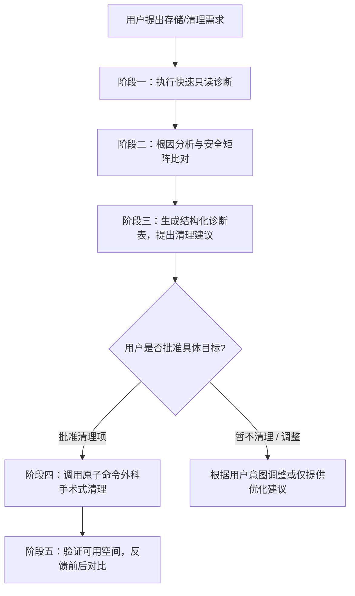

# macOS 智能存储诊断与安全清理专家技能 (Mac Cleaner Skill)

本技能为 AI 智能体（如 Antigravity、Claude Code 等）提供一套专业的 macOS 存储排查、归因诊断与人机协同安全清理的专家框架。

> [!IMPORTANT]
> **设计哲学：智能体原生 (Agent-Native)，彻底摒弃“应用程序”设计模式**
> - **不使用独立 GUI 应用程序**：不生成 `.app`、`.command` 或弹出浏览器本地网页，所有的交互在对话界面内自然进行。
> - **不使用阻塞式的交互式 Shell 脚本**：不使用 `read -r` 或命令行选单挂起智能体。
> - **智能体即操作员**：智能体负责执行只读扫描，向用户汇报结构化报告与建议；在获得用户明确确认后，直接调用标准的系统或开发工具原子命令完成精准定向清理。

---

## 🧠 智能体的核心心智模型 (Mental Model)

1. **“系统数据 (System Data)” 不是一个物理文件夹**：
   - 苹果系统设置中的“系统数据”或“macOS”是一个**动态剩余分类**（计算方式：总已用空间 - 应用程序本体 - 媒体文件 - 文稿 - iCloud）。
   - 它主要由：**APFS 本地快照**、**沙盒应用数据 (`~/Library/Containers`)**、**应用持久配置 (`~/Library/Application Support`)**、**系统与用户级缓存 (`~/Library/Caches`)**、**底层沙盒临时区 (`/private/var/folders`)** 以及 **可清除空间 (Purgeable Space)** 构成。
   - **严禁**向用户承诺有某个“系统数据文件夹”可以直接一键清空。

2. **以底层文件系统可用空间 (`df -h /`) 为唯一检验准则**：
   - 苹果图形界面的“存储空间”严重依赖 Spotlight 索引，更新具有滞后性。
   - 智能体验证清理成效时，必须以 `df -h /` 中的实际可用空间 (`Avail`) 为准。

3. **零误删与安全红线原则 (Zero Data Loss Rules)**：
   - 🚨 **系统保护区严禁修改**：绝不触碰 `/System`、`/Library`（非缓存类子目录）、`/private/var/vm`（交换分区与睡眠镜像）和 `/private/var/folders`。系统底层临时区若需释放，指导用户**彻底关机重启**即可自动回收。
   - 🚨 **聊天与协同软件沙盒禁止命令行强删**：微信 (`com.tencent.xinWeChat`)、企业微信 (`com.tencent.WeWorkMac`)、飞书 (`LarkShell`)、钉钉等位于 `~/Library/Containers`。直接删除会导致本地 SQLite 数据库损坏，**必须指导用户在客户端内进入【设置 -> 存储空间】安全清理**。
   - 🚨 **用户文稿与 Docker 命名数据卷禁止盲删**：`~/Documents`、`~/Desktop`、Docker Volumes 默认属于用户核心生产数据，未经明确确认绝不删除。

---

## 🔄 智能体标准工作流程 (Agent Workflow)



---

## 阶段一：执行非破坏性只读诊断 (Read-Only Diagnostics)

智能体在提出任何清理操作前，必须先获取当前的真实空间分布数据。

### 首选：运行技能内置的只读诊断脚本
本脚本 100% 只读，无任何修改操作，也不会有交互式输入挂起智能体：
```zsh
zsh ~/.gemini/config/skills/mac_cleaner/scripts/diagnose.sh
# 或在仓库根目录下运行：
zsh scripts/diagnose.sh

# 如需深度排查个人主目录（扫描一级子目录大小，适合空间极度告急时）：
zsh scripts/diagnose.sh --deep
```

### 备选：使用标准命令行原子指令排查
如果无法运行脚本，智能体可直接组合运行以下标准只读命令：
```zsh
# 1. 检查磁盘根卷可用空间
df -h /

# 2. 检查 APFS 快照（常导致数十 GB 隐形占用）
tmutil listlocalsnapshots / 2>/dev/null

# 3. 检查主要用户目录大小分布
du -sh ~/Library/Caches ~/Library/Containers ~/Library/Application\ Support ~/Library/Developer ~/Downloads ~/.Trash 2>/dev/null

# 4. 检查常见开发者运行时缓存与 Docker
du -sh ~/.npm/_cacache ~/.gradle/caches ~/.cache ~/Library/Caches/Homebrew 2>/dev/null || true
docker system df 2>/dev/null || true

# 5. 用户缓存 Top 8 占用
cd ~/Library/Caches 2>/dev/null && du -sm * 2>/dev/null | sort -nr | head -n 8 | awk '{print $1 " MB\t" $2}'
```

---

## 阶段二：多维度根因归类与安全矩阵 (Safety Matrix)

智能体根据诊断数据，将扫描结果对照下表进行风险评估与归类：

| 分类 | 路径 / 目标 | 风险级别 | 影响与处理策略 |
| :--- | :--- | :---: | :--- |
| **应用临时缓存** | `~/Library/Caches/*` | 🟢 安全可删 | 临时网页、缩略图和更新包。删除后应用下次启动按需重新拉取，通常能安全释放数 GB 至数十 GB。 |
| **开发构建产物** | Xcode `DerivedData`<br>`~/.gradle/caches`<br>`~/.npm/_cacache` | 🟢 安全可删 | 编译中间文件或全局包缓存，工具在后续构建时会自动重新生成或下载。 |
| **Homebrew 缓存** | `brew cleanup` | 🟢 安全可删 | 清除已安装工具的旧版本和下载的源码包。 |
| **下载目录历史安装包**| `~/Downloads/*.dmg`, `*.pkg` | 🟡 需确认列表 | 下载后遗留的安装镜像，占用通常很大。建议智能体列出文件名，经用户同意后清除。 |
| **废纸篓内容** | `~/.Trash/*` | 🟡 需明确确认 | 用户丢弃的文件，但清空不可逆。须经用户明确确认后清空。 |
| **Docker 悬空对象** | `docker system prune -f` | 🟡 需明确确认 | 清理未运行的容器与悬空镜像；**严禁未经同意附带 `-v` 删除 Named Volumes**。 |
| **Time Machine 快照** | `com.apple.TimeMachine.*` | 🟠 需谨慎处理 | 本地快照堆积。可用 `tmutil thinlocalsnapshots` 申请精简，不可暴力强删。 |
| **系统更新快照** | `com.apple.os.update-*` | 🔴 **严禁强删** | 系统更新专属 APFS 快照，重启安装完毕后由 macOS 自行释放。 |
| **办公/聊天沙盒** | 微信、企业微信、飞书、钉钉<br>`~/Library/Containers/*` | 🔴 **严禁命令行删除** | 包含聊天记录与接收的文档，删除必损坏数据库。**必须引导用户在客户端内进入存储管理清理**。 |
| **底层临时与虚拟内存**| `/private/var/folders/`<br>`/private/var/vm/` (swap) | 🔴 **严禁手动删除** | 直接删除易导致活跃应用崩溃。**建议用户彻底关机并重新开机**。 |

---

## 阶段三：向用户汇报结构化诊断报告与建议

智能体获取数据后，以清晰明了的 Markdown 格式向用户呈现，例如：

> **当前系统磁盘状态**：可用空间 **8.8 GB** / 总容量 460 GB (已用 58%)。
> 
> **排查到的可清理项建议**：
> 1. 🟢 **用户应用临时缓存 (`~/Library/Caches`)**：当前占用 **9.5 GB**（主要是 Workbuddy 3.3G、微信临时缓存 1.8G、Chrome 1.5G、JetBrains 1.5G）
> 2. 🟢 **历史下载安装包 (`~/Downloads/*.dmg`)**：当前占用 **4.2 GB**（共 7 个安装镜像文件）
> 3. 🟢 **开发依赖缓存 (`~/.npm`)**：当前占用 **484 MB**
> 
> **巨无霸应用特别提醒（需在应用内清理）**：
> • **微信聊天沙盒** 当前占用 **24.2 GB**，企业微信占用 **5.4 GB**。强力建议打开微信客户端「设置 -> 通用/存储空间」清理聊天中的大视频与原图。
> 
> 请问是否批准我为您执行第 1~3 项的安全清理？

---

## 阶段四：外科手术式定向清理 (Surgical Cleanup Playbook)

一旦获得用户授权，智能体直接调用对应非交互式的原子命令执行清理。

### 1. 清理用户临时应用缓存
```zsh
# 安全清空用户应用缓存（被占用的文件会自动跳过）
rm -rf ~/Library/Caches/* 2>/dev/null || true
```

### 2. 清理开发环境与构建缓存
```zsh
# Xcode DerivedData 构建产物
rm -rf ~/Library/Developer/Xcode/DerivedData/* 2>/dev/null || true

# npm 全局缓存
npm cache clean --force 2>/dev/null || true
rm -rf ~/.npm/_cacache 2>/dev/null || true

# Gradle 缓存
rm -rf ~/.gradle/caches/* 2>/dev/null || true

# Homebrew 过期包与旧版本
brew cleanup --prune=all 2>/dev/null || true
```

### 3. 清理 Docker 悬空资源（保留数据卷）
```zsh
docker system prune -f 2>/dev/null || true
```

### 4. 精简 Time Machine 本地 APFS 快照
```zsh
# 申请释放 20GB 本地快照空间（需 sudo 权限）
sudo tmutil thinlocalsnapshots / 21474836480 4 2>/dev/null || true
```

### 5. 清理下载目录中的安装包与清空废纸篓（经用户明确许可后）
```zsh
# 清理下载目录中的 dmg / pkg 安装包
find ~/Downloads -maxdepth 1 -type f \( -name "*.dmg" -o -name "*.pkg" -o -name "*.iso" \) -delete 2>/dev/null || true

# 清空废纸篓
rm -rf ~/.Trash/* 2>/dev/null || true
```

---

## 阶段五：空间对比与闭环验证

任何清理操作完成后，智能体必须重新执行：
```zsh
df -h /
```
并向用户汇报成效对比表：

| 检查项 | 清理前 | 清理后 | 净释放空间 |
| :--- | :---: | :---: | :---: |
| **系统可用空间 (Avail)** | 8.8 GB | 22.5 GB | **+13.7 GB** |

并根据剩余情况提供贴心指引：
- 如果“系统数据”依然偏大，提示用户完成一次**彻底关机与重新开机**以释放系统 swap 与底层临时沙盒；
- 提示用户按需进入微信/飞书客户端清理聊天内的大文件。
